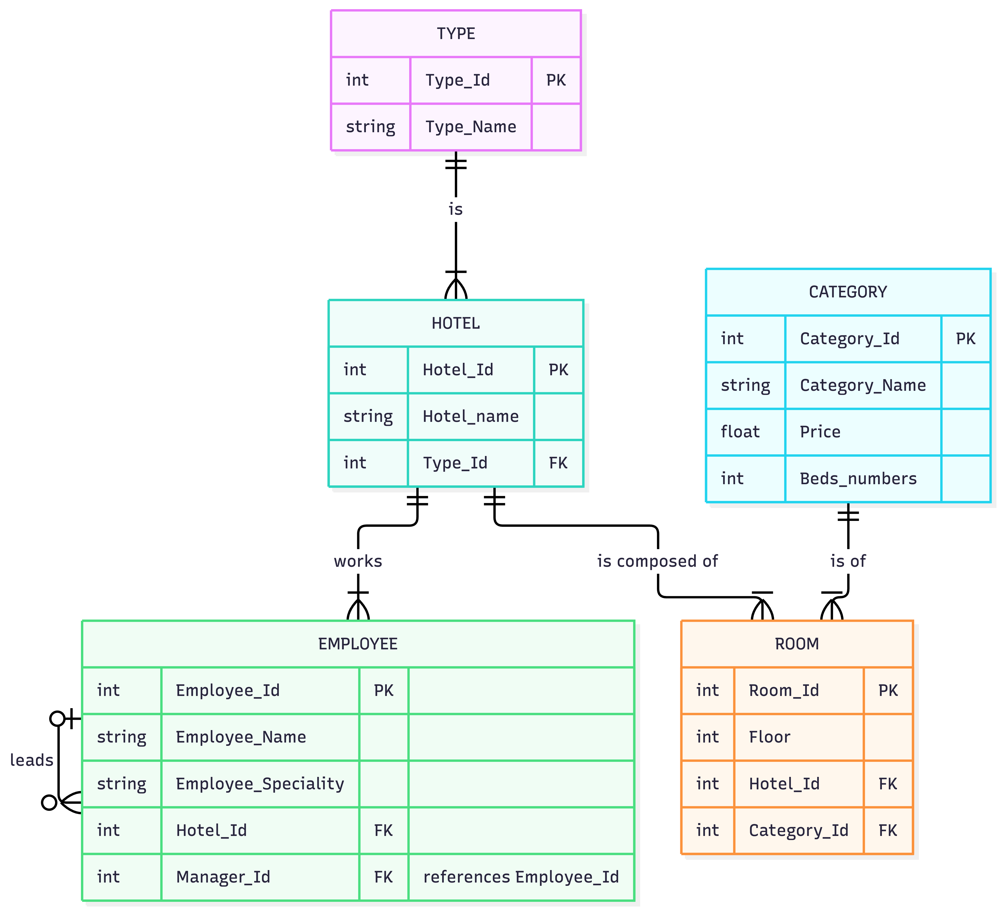

# Relational Model - Hotel Management

This repo contains my relational model for the hotel checkpoint (Relational Databases course).

A director built several hotels in a tourist area and wants a database to manage his data. He gave us an entity-relationship model, and the goal is to convert it into a relational diagram.

## Relational diagram

## Conversion rules I used

- Each entity becomes a table, and its identifier becomes the primary key.
- For a one-to-many relationship (1..1 on one side, 1..N on the other), the primary key of the "one" side goes into the "many" side as a foreign key.
- The relationships here carry no attributes and none of them is many-to-many, so no extra join table is needed.

## Relationships

- **Hotel - Type (is)**: a hotel has one type, and a type can be shared by many hotels. `Type_Id` goes into HOTEL.
- **Hotel - Room (is composed)**: a room belongs to one hotel, and a hotel has many rooms. `Hotel_Id` goes into ROOM.
- **Room - Category (is of)**: a room has one category, and a category can apply to many rooms. `Category_Id` goes into ROOM.
- **Hotel - Employee (works)**: an employee works in one hotel, and a hotel has many employees. `Hotel_Id` goes into EMPLOYEE.
- **Employee - Employee (leads)**: this is a reflexive relationship. An employee is led by one manager, and a manager can lead many employees. It becomes a foreign key `Manager_Id` in EMPLOYEE that points to `Employee_Id` of the same table. It can be NULL for the employee at the top (the one nobody leads). In the same way, a regular employee may lead nobody, so in the diagram I made this relationship optional on both sides, even though the ER model says 1..1 / 1..N.

## Tables

Primary keys are in **bold**, foreign keys start with `#`.

- TYPE (**Type_Id**, Type_Name)
- HOTEL (**Hotel_Id**, Hotel_name, #Type_Id)
- CATEGORY (**Category_Id**, Category_Name, Price, Beds_numbers)
- ROOM (**Room_Id**, Floor, #Hotel_Id, #Category_Id)
- EMPLOYEE (**Employee_Id**, Employee_Name, Employee_Speciality, #Hotel_Id, #Manager_Id)

The diagram was made with Mermaid.
